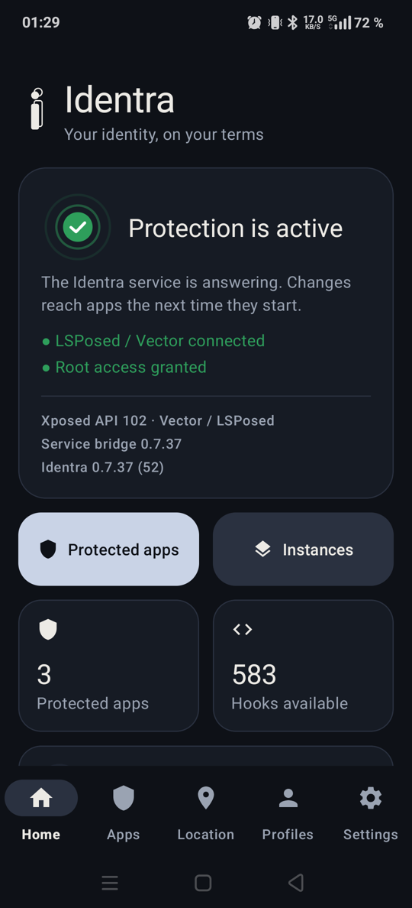
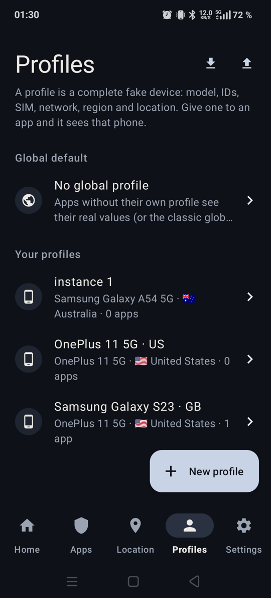
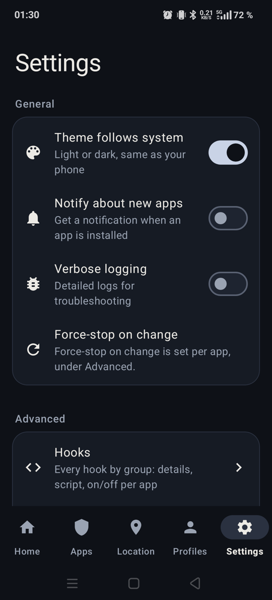

<p align="center">
  
</p>

<h1 align="center">Identra</h1>

<p align="center">
  <a href="https://github.com/ribotcarwijj/Identra/releases/latest"></a>
  <a href="https://github.com/ribotcarwijj/Identra/releases"></a>
</p>

<p align="center">
  
  
  
  
</p>

**Identra decides what apps can learn about your phone.** Model, Android build, IDs, IMEI, SIM, phone number, Wi‑Fi and Bluetooth addresses, language, time zone, location, sensors and more — controlled app by app, with complete fake device profiles you can save, switch and restore.

Identra is an Xposed module for rooted Android, built on the modern **libxposed API 102** (Vector / LSPosed).

| | |
|---|---|
| Package | `dev.identra.app` |
| Android | 8.1 (API 27) and newer, tested up to Android 17 |
| Needs | Root (Magisk / KernelSU / APatch) + Vector or LSPosed with libxposed API 102 |
| License | GPL‑3.0 |

## Screenshots

<p align="center">
  
  
  
</p>

## Features

### Per-app protection
- One switch per app turns on a recommended set of protections.
- Fine control per area: **Device, Network, Location, Phone & SIM, Apps & accounts, Sensors & clipboard, Trackers, Stealth**.
- **Advanced** view with every hook group, the app's own values, logs and "force stop on change".
- Search and filter apps (Protected / User / System).

### Fake location
- Search any place or type coordinates, or tap / long‑press the map.
- Set it for all apps or for one app.
- **Favourites** for places you use often.
- Exact or coarse mode (blur your real position by a radius) and an optional small random offset.
- "My location" shows your real position and never invents one.

### Profiles — a whole fake phone per app
- A profile is a complete, consistent device: model and build, Android ID and other IDs, IMEI, SIM operator and number, Wi‑Fi/Bluetooth MACs, language, time zone, location, screen and memory.
- Values fit together: a Swedish SIM gets a Swedish number, language and time zone; the IMEI belongs to the phone model.
- Create from a **random real device**, a **random device for a country**, **this phone**, a duplicate, or empty.
- Re‑roll one value, one section or everything; **lock** values you want to keep; **change country** in one tap.
- Apply a profile to one or many apps, choosing what happens to the app's data:
  - keep the app's data,
  - fresh app data (like a new install),
  - **separate data per profile** — switching profiles swaps the app's data too, nothing is deleted until the save has worked.
- **Global default** profile for every protected app without its own profile.
- Export / import profiles as JSON.

### Found in this app
- Shows which identifiers and APIs an app actually uses, without any setup.
- **Likely**: a static scan of the app's code (nothing is executed).
- **Seen**: an observe‑only mode that records what the app really reads at runtime.
- One tap gives the app a new identity for exactly what it uses.

### Auto-update
- Identra checks this repository's GitHub Releases (every time you open the app) and shows new versions with their changelog.
- **Check for updates** and an **Auto‑check** switch in the side menu. One tap downloads and installs the update through root and reopens Identra.

### Advanced tools
Collections, hook definitions (Lua and native Java interceptors), all values, CPU maps, database, backup & restore, logs.

## Install

1. Root your phone and install **Vector** or **LSPosed** (libxposed API 102).
2. Download the latest APK from [Releases](https://github.com/ribotcarwijj/Identra/releases) and install it.
3. In the Vector/LSPosed manager enable Identra with this scope:
   - **System Framework**
   - **Settings Storage** (`com.android.providers.settings`)
   - **Identra**
4. Soft reboot once so the system part loads. Later updates don't need a reboot.
5. Open Identra — the **Home** tab says *Protection is active* when everything runs.

Full walkthrough: [docs/USER_GUIDE.md](docs/USER_GUIDE.md).

## Tips
- After a change, fully close and reopen the app you are testing.
- If an app breaks, turn its categories off one at a time, or remove its profile.
- Hardware attestation / Play Integrity device verdicts can't be changed by any Xposed module and stay the same across profiles.

## Build

```bash
python3 tools/gen_found_index.py   # generates the "Found in this app" index from hooks.json
./gradlew assembleDebug            # JDK 17, Android SDK 34, NDK 27.2
```

GitHub Actions builds every push (`.github/workflows/build.yml`).

## License

Identra is free software under the **GNU GPL v3.0** — see [LICENSE](LICENSE).

Contains code from XPrivacyLua (M66B) and XPL‑EX (0bbedCode), used under the GPL‑3.0.
